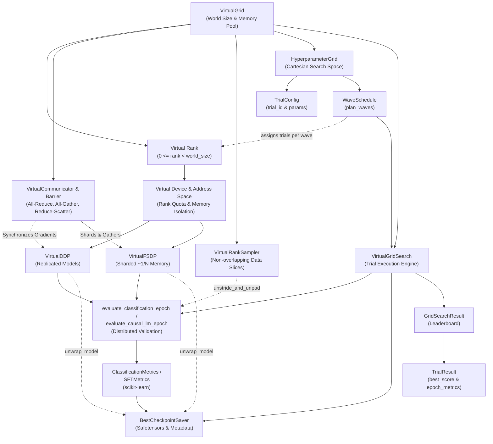

# Glossary

Canonical domain vocabulary for `amd-spare-bedroom`. Use these terms consistently in code, tests, docs, and issue discussions.

## Terms

### Virtual Grid
The simulated multi-rank cluster topology mapped onto a single physical AMD ROCm GPU (such as `gfx1151` with 96 GB unified VRAM). Defines the world size, rank membership, and total memory allocation.

### Virtual Rank
An integer identifier (`0 <= rank < world_size`) assigned to an emulated worker process/thread within the Virtual Grid.

### Virtual Device & Address Space
The isolated runtime context allocated to a single Virtual Rank. Enforces rank-scoped memory limits and namespace separation on top of the underlying physical ROCm device (`hip:0` / `cuda:0`).

### Lockstep Barrier
A synchronization barrier ensuring all virtual ranks execute forward, backward, and optimization steps in deterministic lockstep, simulating synchronized multi-device execution.

### Virtual Communicator
The collective communications engine (implemented in `VirtualCommunicator`) providing inter-rank primitives (`all_reduce`, `broadcast`, `gather`, `scatter`, `barrier`). Leverages zero-copy / unified memory buffers on APUs for fast local reductions.

### Virtual DDP (Distributed Data Parallel)
Emulation of PyTorch's `DistributedDataParallel`. Holds a full model replica per virtual rank, feeds rank-sharded data, hooks backward gradients to trigger All-Reduce across ranks, and executes synchronized parameter updates.

### Virtual FSDP (Fully Sharded Data Parallel)
Emulation of PyTorch's FSDP (implemented in `VirtualFSDP`). Shards model parameters, gradients, and optimizer states across virtual ranks, executing all-gather before forward/backward computations and reduce-scatter on gradients to achieve ~`1 / world_size` per-rank memory scaling.

### Virtual Rank Sampler
A deterministic, seedable dataset partitioner that produces non-overlapping batch splits for each Virtual Rank without data duplication or cross-rank leakage.

### Classification & Causal LM SFT Metrics
Structured evaluation scores for sequence classification (`ClassificationMetrics`: `accuracy`, `f1`, `precision`, `recall`, `loss` via `compute_classification_metrics` and `evaluate_classification_epoch`) and causal language model Supervised Fine-Tuning (`SFTMetrics`: `eval_loss`, `perplexity`, and masked `token_accuracy` via `compute_sft_metrics` and `evaluate_causal_lm_epoch`), reconstructing sequential dataset order via `VirtualRankSampler.unstride_and_unpad`.

### Best-Metric Checkpoint Saver
A persistence manager (`BestCheckpointSaver`) that maintains a single loadable HuggingFace `safetensors` model (`model.safetensors`, `config.json`), tokenizer, and `checkpoint_metadata.json` directory, atomically overwriting it when the monitored metric improves (`f1` by default for classification, `perplexity` for causal LM SFT) and formatting the winning hyperparameter summary (`BestCheckpointSaver.format_winner_summary`).

### Virtual Grid Search
A parallel hyperparameter exploration mode (`VirtualGridSearch`, `HyperparameterGrid`, `WaveSchedule`, `TrialConfig`, `TrialResult`, `GridSearchResult`) in which each Virtual Rank in a `VirtualGrid` executes an independent hyperparameter trial without cross-rank gradient averaging, scheduling $N$ total trials in sequential waves of up to `world_size` concurrent trials, persisting a single best loadable checkpoint, and announcing the winning combination on the final stdout line (`GridSearchResult.format_winner_announcement`).

## Architecture & Concept Relationships

