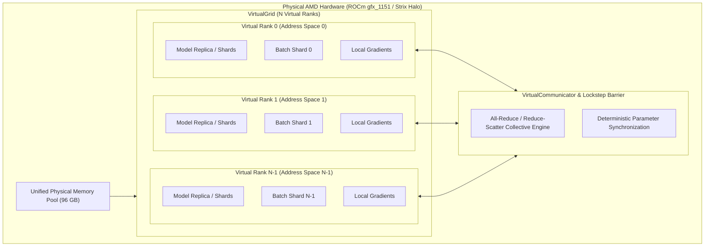
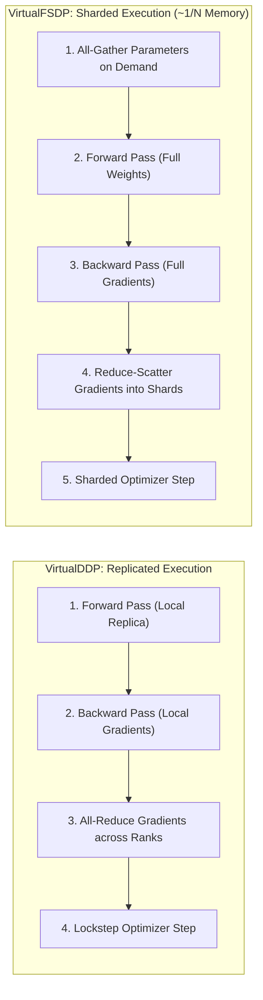

# AMD Spare Bedroom (`amd-spare-bedroom`)

[](LICENSE)

Emulate multiple AMD GPU devices and distributed ranks (DDP, FSDP) with isolated address spaces inside a unified high-capacity VRAM pool on AMD ROCm (targeting `gfx_1151` / AMD Strix Halo).

---

## Overview

This repo positions itself as a playground for parallelism techniques for those who might have more VRAM than they need for a given workflow. Think of a [spare bedroom](https://advancedhouseplans.com/blogs/the-best-things-to-do-with-your-spare-bedroom) you might have in your house. If no one's using it, you could put a home office, gym or art studio in there. Well this repo is kind of like that. Except the goal is to experiment with different virtual devices in lockstep across the unified VRAM you have to spare.

Modern unified-memory APUs—such as the **AMD Ryzen AI Max+ 395 with Radeon 8060S (`gfx_1151`)**—provide massive VRAM allocations (up to **96 GB** or **128 GB** visible via `amdgpu_top` and `rocm-smi`). 

While this hardware typically appears to the operating system as a single monolithic GPU (`cuda:0` / `hip:0`), 96 GB is more than enough memory to host entire multi-node distributed training topologies.

**`amd-spare-bedroom`** partitions this unified physical VRAM into an emulated grid of virtual AMD GPU ranks:
- **Virtual Devices & Address Spaces**: Each rank operates inside its own bounded virtual address space and memory quota.
- **True Distributed Mechanics**: Replicates Distributed Data Parallel (**DDP**) and Fully Sharded Data Parallel (**FSDP**) mechanisms without requiring a multi-GPU cluster.
- **Lockstep Execution & Synchronization**: Synchronizes forward, backward, and optimizer passes across ranks using lockstep execution barriers and collective all-reduce operations.
- **Rank-Isolated Data Pipelines**: Feeds each virtual device with rank-specific, seedable datasets and mini-batch shards.
- **Real-World Workloads**: Prototype and validate real-world models (e.g., training `bert-base-uncased` on GLUE tasks) locally under exact distributed conditions.

---

## Key Concepts & Architecture



### Distributed Execution Flow



1. **`VirtualGrid`**: Defines the virtual cluster topology (world size, virtual ranks, memory quota per rank, device backend).
2. **`VirtualDevice`**: Represents an emulated GPU rank with isolated tensor namespaces, memory limits, and stream coordination.
3. **`VirtualCommunicator`**: Provides collective communication primitives (`all_reduce`, `broadcast`, `all_gather`, `reduce_scatter`, `barrier`).
4. **`VirtualDDP`**: A drop-in wrapper mirroring `torch.nn.parallel.DistributedDataParallel` that coordinates gradient reduction across virtual ranks.
5. **`VirtualFSDP`**: Fully Sharded Data Parallel wrapper sharding parameters, gradients, and optimizer states across virtual ranks, executing All-Gather for forward passes and Reduce-Scatter for gradients to reduce memory footprint by ~`1 / world_size`.
6. **`VirtualRankSampler`**: Distributes non-overlapping, seedable dataset slices to each virtual rank.
7. **`AmpGradScalerState` & `resolve_amp_dtype`**: Coordinates Automatic Mixed Precision (`bfloat16`/`float16`) execution with autocast and dynamic loss scaling across virtual ranks.
8. **`ClassificationMetrics` & `evaluate_classification_epoch`**: Evaluates distributed `VirtualDDP` and `VirtualFSDP` models across ranks without sampler padding distortion, computing `accuracy`, `f1`, `precision`, and `recall` via `scikit-learn`.
9. **`SFTMetrics`, `evaluate_causal_lm_epoch` & `evaluate_causal_lm_model`**: Evaluates distributed and single-device Causal Language Models during Supervised Fine-Tuning (SFT), computing token-level validation cross-entropy loss, **Perplexity** ($\exp(\min(\mathcal{L}_{\text{eval}}, 20.0))$), and **Masked Next-Token Accuracy** via `scikit-learn` while ignoring `-100` prompt/padding mask tokens.
10. **`BestCheckpointSaver`**: Persists a single loadable HuggingFace `safetensors` model (`model.safetensors`, `config.json`), tokenizer, and metadata directory, atomically overwriting it when the monitored metric improves (`f1` by default for classification, `perplexity` by default for SFT).
11. **`HyperparameterGrid` & `WaveSchedule`**: Expands Cartesian hyperparameter candidate search spaces into deterministic `TrialConfig` instances and partitions them into sequential waves of concurrent virtual ranks.
12. **`VirtualGridSearch`**, **`TrialResult`** & **`GridSearchResult`**: Multi-rank hyperparameter trial execution engine running isolated rank replicas, deterministic wave scheduling, and global leaderboard aggregation with canonical final-line winner announcement.

---

## Tooling & Prerequisites

- **Python**: `>=3.12`
- **Environment Manager**: [`uv`](https://github.com/astral-sh/uv)
- **Hardware Target**: AMD ROCm GPU (initial target: `gfx_1151` / RDNA 3.5 / Radeon 8060S with up to 96 GB VRAM)
- **Monitoring**: `amdgpu_top` or `rocm-smi`

---

## Getting Started

### 1. Initialize Virtual Environment with `uv`

```bash
uv venv --python 3.12
source .venv/bin/activate
```

### 2. Install Dependencies

The project is pre-configured in [`pyproject.toml`](pyproject.toml) with the official AMD ROCm nightly index for `gfx1151` (`https://rocm.nightlies.amd.com/v2/gfx1151`). Simply sync the environment:

```bash
uv sync --extra dev
```

To manually install or update ROCm PyTorch wheels for `gfx_1151`:

```bash
uv pip install --extra-index-url https://rocm.nightlies.amd.com/v2/gfx1151 torch
```

### 3. Environment Configuration (`.env`)

Copy the provided environment template to `.env` to configure ROCm target architectures, memory allocators, and optional HuggingFace access tokens:

```bash
cp .env.example .env
```

---

## Running Examples

Experiments can be executed using pre-built YAML configurations in [`configs/`](configs/), custom recipes, or direct command-line arguments.

### 1. Quick Start with YAML Recipes

```bash
# BERT sequence classification on MRPC using replicated VirtualDDP (4 ranks):
uv run examples/train_bert_glue.py --config configs/bert_mrpc_ddp.yaml

# BERT sequence classification on MRPC using sharded VirtualFSDP (4 ranks):
uv run examples/train_bert_glue.py --config configs/bert_mrpc_fsdp.yaml

# Llama 3.2 1B instruction fine-tuning using sharded VirtualFSDP (4 ranks):
uv run examples/train_llama_sft.py --config configs/llama_sft_fsdp.yaml

# Multi-rank hyperparameter grid search across LR, weight decay, and batch size:
uv run examples/train_bert_glue.py --config configs/bert_mrpc_grid.yaml
```

### 2. Overriding Configuration Parameters on the Fly

You can selectively override any parameter on the command line without modifying the YAML file:

```bash
# Launch BERT with batch size 16 and learning rate 5e-5:
uv run examples/train_bert_glue.py --config configs/bert_mrpc_ddp.yaml --batch-size 16 --lr 5e-5

# Evaluate across 8 virtual ranks on SST-2:
uv run examples/train_bert_glue.py --config configs/bert_mrpc_fsdp.yaml --ranks 8 --task-name sst2
```

### 3. Direct Command-Line Launch (Bypassing YAML)

If preferred, you can still launch scripts entirely with direct arguments:

```bash
uv run examples/train_bert_glue.py --model-name bert-base-uncased --task-name mrpc --parallelism fsdp --ranks 4 --epochs 3 --batch-size 8 --lr 2e-5 --amp bf16 --eval-metric f1 --checkpoint-dir checkpoints/best_bert_mrpc --max-steps 0
```

### 4. Fast Local Smoke Tests (Offline / No Downloads)

```bash
# BERT classification smoke test with compact 2-layer model and synthetic data:
uv run examples/train_bert_glue.py --synthetic --use-tiny-bert --ranks 2 --max-steps 2

# Llama 3.2 1B SFT smoke test with compact 2-layer model and synthetic data:
uv run examples/train_llama_sft.py --synthetic --use-tiny-llama --ranks 2 --max-steps 2
```

---

## Configuration & CLI Options Reference

For a complete catalog of all configuration keys, environment variables, command-line arguments, precedence rules, and custom recipe instructions, see [`configs/README.md`](configs/README.md).

---

## Hook Scripts

The repository includes a set of lightweight wrapper scripts in [`hooks/`](hooks/) that execute commands through `uv run`:

| Script | Command | Purpose |
| :--- | :--- | :--- |
| [`hooks/run`](hooks/run) | `uv run python "$@"` | Run any Python script with the environment active |
| [`hooks/lint`](hooks/lint) | `uv run ruff check "$@"` | Run Ruff linter checks |
| [`hooks/format`](hooks/format) | `uv run ruff format "$@"` | Run Ruff code formatter |
| [`hooks/typecheck`](hooks/typecheck) | `uv run mypy "$@"` | Run Mypy static type checking |
| [`hooks/test`](hooks/test) | `uv run pytest "$@"` | Run test suite |
| [`hooks/check-all`](hooks/check-all) | Run all of the above | Full pre-commit / pre-push verification |

Usage example:
```bash
./hooks/run examples/train_bert_glue.py --parallelism fsdp --use-tiny-bert --ranks 4 --epochs 2
./hooks/check-all
```

---

## Test-Driven Development (TDD) & Agreed Seams

In accordance with our [TDD Guidelines](AGENTS.md), development proceeds in vertical slices against pre-agreed seams:

- **Seam 1: `VirtualGrid` & Topology**: Allocation, rank assignments, and address space memory budgeting.
- **Seam 2: `VirtualCommunicator` & `LockstepBarrier`**: Inter-rank barrier, tensor all-reduce, and synchronization invariants.
- **Seam 3: `VirtualRankSampler`**: Deterministic dataset partitioning without data leakage across virtual ranks.
- **Seam 4: `VirtualDDP`**: Gradient hook attachment, parameter synchronization, and backward pass all-reduce.
- **Seam 5: `VirtualFSDP` & Collective Sharding**: Parameter sharding (~`1/N` memory), on-demand All-Gather, and gradient Reduce-Scatter.
- **Seam 6: `ClassificationMetrics` & Scikit-Learn Adapters**: Zero-division protection, binary/multiclass auto-averaging, and `ClassificationMetrics` dataclass conversions.
- **Seam 7: Distributed Lockstep Evaluation (`evaluate_classification_epoch`)**: Multi-rank lockstep validation under `eval_forward()`, rank unpadding via `VirtualRankSampler.unstride_and_unpad`, and training state restoration.
- **Seam 8: Single Best-Metric Checkpoint Saving (`BestCheckpointSaver`)**: Monitored metric tracking, HuggingFace `safetensors` + tokenizer persistence, atomic directory overwrite, and winning trial formatting.
- **Seam 9: Hyperparameter Search Space Expansion & Wave Scheduler (`HyperparameterGrid`, `WaveSchedule`, `TrialConfig`)**: Deterministic Cartesian trial expansion, sequential wave partitioning across virtual ranks, and idle rank tracking for partial waves.
- **Seam 10: Multi-Rank Hyperparameter Grid Search Execution Engine (`VirtualGridSearch`, `TrialResult`, `GridSearchResult`)**: Per-rank replica and optimizer isolation, lockstep wave execution with step limits, evaluation aggregation, and single-best safetensors checkpointing.
- **Seam 11: CLI Hyperparameter Grid Search & Winner Announcement (`--grid-search`, `format_winner_announcement`)**: Multi-rank wave execution orchestration from CLI, single best-model safetensors persistence, and canonical final-line winner announcement format.
- **Seam 12: Causal LM SFT Pipeline & Next-Token Metrics (`SFTMetrics`, `evaluate_causal_lm_epoch`)**: Instruction fine-tuning for Llama 3.2 1B, Alpaca label masking (`ignore_index=-100`), validation perplexity, and masked token accuracy.

---

## Continuous Integration (CI)

A credential-free GitHub Actions workflow is configured in [`.github/workflows/ci.yml`](.github/workflows/ci.yml) to automatically run:
- Ruff linting and formatting verification.
- Mypy strict type checking across `src/` and `tests/`.
- Pytest suite on CPU / mocked virtual grids (GPU tests marked with `@pytest.mark.gpu` are skipped in standard CI runners).

---

## Author

Created by [Richard Yue](https://github.com/rsyue) ([@rsyue](https://github.com/rsyue)).

---

## License

This project is licensed under the **Creative Commons Attribution-NonCommercial-NoDerivatives 4.0 International Public License** ([CC BY-NC-ND 4.0](https://creativecommons.org/licenses/by-nc-nd/4.0/)).

Under this license, you are free to:
- **Share** — copy and redistribute the material in any medium or format.

Under the following terms:
- **Attribution (BY)** — You must give appropriate credit, provide a link to the license, and indicate if changes were made. You may do so in any reasonable manner, but not in any way that suggests the licensor endorses you or your use.
- **NonCommercial (NC)** — You may not use the material for commercial purposes.
- **NoDerivatives (ND)** — If you remix, transform, or build upon the material, you may not distribute the modified material.

See the full legal code in the [LICENSE](LICENSE) file or at [creativecommons.org/licenses/by-nc-nd/4.0/legalcode](https://creativecommons.org/licenses/by-nc-nd/4.0/legalcode).


