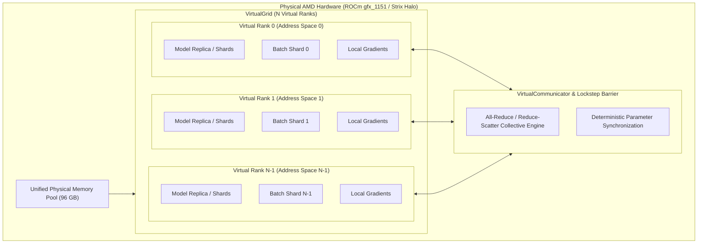
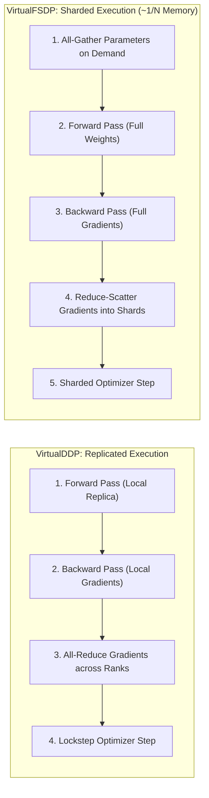

# AMD Spare Bedroom (`amd-spare-bedroom`)

[](LICENSE)
[](https://github.com/rsyue/amd-spare-bedroom/actions/workflows/ci.yml)

Emulate multiple AMD GPU devices and distributed ranks (DDP, FSDP) with isolated address spaces inside a unified high-capacity VRAM pool on AMD ROCm (targeting `gfx_1151` / AMD Strix Halo).

---

## Overview

This repo positions itself as a playground for parallelism techniques for those who might have more VRAM than they need for a given workflow. Think of a [spare bedroom](https://advancedhouseplans.com/blogs/the-best-things-to-do-with-your-spare-bedroom) you might have in your house. If no one's using it, you could put a home office, gym or art studio in there. Well this repo is kind of like that. Except the goal is to experiment with different virtual devices in lockstep across the unified VRAM you have to spare.

Modern unified-memory APUs—such as the **AMD Ryzen AI Max+ 395 with Radeon 8060S (`gfx_1151`)**—provide massive VRAM allocations (up to **96 GB** or **128 GB** visible via `amdgpu_top` and `rocm-smi`).

While this hardware typically appears to the operating system as a single monolithic GPU (`cuda:0` / `hip:0`), 96 GB is more than enough memory to host entire multi-node distributed training topologies.

**`amd-spare-bedroom`** partitions this unified physical VRAM into an emulated grid of virtual AMD GPU ranks:
- **Virtual Devices & Address Spaces**: Each rank operates inside its own bounded virtual address space and memory quota.
- **True Distributed Mechanics**: Replicates Distributed Data Parallel (**DDP**) and Fully Sharded Data Parallel (**FSDP**) mechanisms without requiring a multi-GPU cluster.
- **Lockstep Execution & Synchronization**: Synchronizes forward, backward, and optimizer passes across ranks using lockstep execution barriers and collective all-reduce operations.
- **Rank-Isolated Data Pipelines**: Feeds each virtual device with rank-specific, seedable datasets and mini-batch shards.
- **Real-World Workloads**: Prototype and validate real-world models (e.g., training `bert-base-uncased` on GLUE tasks or instruction fine-tuning `Llama-3.2-1B`) locally under exact distributed conditions.

---

## Architecture & Distributed Execution



### Distributed Modes



### Core Abstractions
1. **`VirtualGrid`**: Defines the virtual cluster topology (world size, virtual ranks, memory quota per rank, device backend).
2. **`VirtualCommunicator`**: Collective communication primitives (`all_reduce`, `broadcast`, `all_gather`, `reduce_scatter`, `barrier`).
3. **`VirtualDDP`**: Coordinates gradient all-reduction across virtual ranks replicating DDP mechanics.
4. **`VirtualFSDP`**: Shards parameters, gradients, and optimizer states across virtual ranks, executing All-Gather for forward passes and Reduce-Scatter for gradients to reduce memory footprint by ~`1 / world_size`.
5. **`VirtualGridSearch`**: Multi-rank hyperparameter optimization engine executing concurrent trial waves with Cartesian candidate expansion and safetensors checkpointing.
6. **`BestCheckpointSaver`**: Persists and updates the single best HuggingFace `safetensors` model and tokenizer based on monitored metrics.

---

## Getting Started

### 1. Prerequisites
- **Python**: `==3.12.*`
- **Environment Manager**: [`uv`](https://github.com/astral-sh/uv)
- **Target Hardware**: AMD ROCm GPU (initial target: `gfx_1151` / RDNA 3.5 / Radeon 8060S with unified VRAM)

### 2. Quick Setup

```bash
# Initialize virtual environment with uv:
uv venv --python 3.12
source .venv/bin/activate

# Install dependencies with official AMD ROCm nightly index (pre-configured in pyproject.toml):
uv sync

# Copy environment template:
cp .env.example .env
```

---

## Running Experiments

Experiments can be executed using pre-built YAML configurations in [`configs/`](configs/), custom recipes, or direct command-line arguments.

### 1. Quick Start with YAML Recipes

```bash
# BERT sequence classification on MRPC using replicated VirtualDDP (4 ranks):
uv run python examples/train_bert_glue.py --config configs/bert_mrpc_ddp.yaml

# BERT sequence classification on MRPC using sharded VirtualFSDP (4 ranks):
uv run python examples/train_bert_glue.py --config configs/bert_mrpc_fsdp.yaml

# Llama 3.2 1B instruction fine-tuning using sharded VirtualFSDP (4 ranks):
uv run python examples/train_llama_sft.py --config configs/llama_sft_fsdp.yaml

# Multi-rank hyperparameter grid search across LR, weight decay, and batch size:
uv run python examples/train_bert_glue.py --config configs/bert_mrpc_grid.yaml
```

### 2. Command-Line Overrides

Override any configuration parameter on the fly without editing YAML files:

```bash
# Override batch size and learning rate:
uv run python examples/train_bert_glue.py --config configs/bert_mrpc_ddp.yaml --batch-size 16 --lr 5e-5

# Evaluate across 8 virtual ranks on SST-2:
uv run python examples/train_bert_glue.py --config configs/bert_mrpc_fsdp.yaml --ranks 8 --task-name sst2
```

### 3. Fast Local Smoke Tests (Offline / No Model Downloads)

```bash
# BERT classification smoke test with compact 2-layer model and synthetic data:
uv run python examples/train_bert_glue.py --synthetic --use-tiny-bert --ranks 2 --max-steps 2

# Llama 3.2 1B SFT smoke test with compact 2-layer model and synthetic data:
uv run python examples/train_llama_sft.py --synthetic --use-tiny-llama --ranks 2 --max-steps 2
```

For complete documentation on all configuration options, YAML schemas, environment variables, and CLI flags, consult [`configs/README.md`](configs/README.md).

---

## Contributing & Development

For local quality assurance commands (`ruff`, `mypy`, `pytest`), architectural seams (Seams 1–13), and pull request guidelines, please refer to [**`CONTRIBUTING.md`**](CONTRIBUTING.md).

---

## Continuous Integration (CI)

A credential-free GitHub Actions workflow is configured in [`.github/workflows/ci.yml`](.github/workflows/ci.yml) to automatically execute:
- **Lint & Format (Ruff)**: Fast syntax, style, and code formatting validation with inline PR annotations.
- **Typecheck (Mypy)**: Strict static type checking across `src/` and `tests/`.
- **Unit Tests (Pytest)**: Full suite of unit tests on CPU / mocked virtual grids (`-m "not gpu"`).

---

## License

This project is licensed under the **MIT License**.

Permission is granted to reproduce, distribute, modify, and use this software with attribution. See the full legal code in the [LICENSE](LICENSE) file.

---

## Author

Created by [Richard Yue](https://github.com/rsyue) ([@rsyue](https://github.com/rsyue)).
