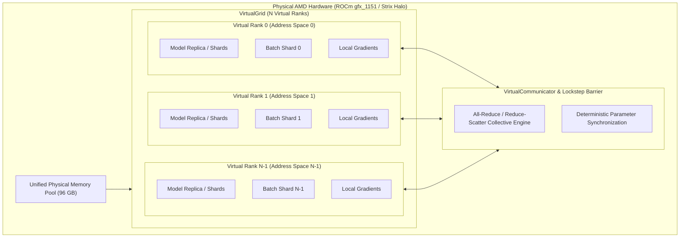
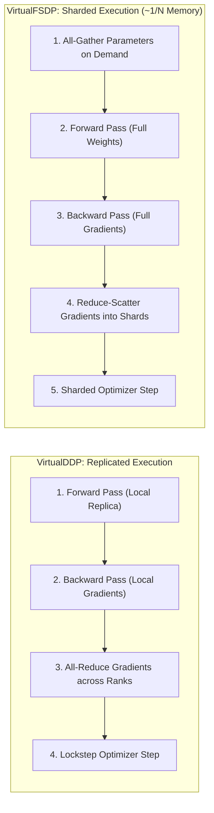

# AMD Spare Bedroom (`amd-spare-bedroom`)

[](LICENSE)

Emulate multiple AMD GPU devices and distributed ranks (DDP, FSDP) with isolated address spaces inside a unified high-capacity VRAM pool on AMD ROCm (targeting `gfx_1151` / AMD Strix Halo).

---

## Overview

This repo positions itself as a playground for parallelism techniques for those who might have more VRAM than they need for a given workflow. Think of a [spare bedroom](https://advancedhouseplans.com/blogs/the-best-things-to-do-with-your-spare-bedroom) you might have in your house. If no one's using it, you could put a home office, gym or art studio in there. Well this repo is kind of like that. Except the goal is to experiment with different virtual devices in lockstep across the unified VRAM you have to spare.

Modern unified-memory APUs—such as the **AMD Ryzen AI Max+ 395 with Radeon 8060S (`gfx_1151`)**—provide massive VRAM allocations (up to **96 GB** or **128 GB** visible via `amdgpu_top` and `rocm-smi`). 

While this hardware typically appears to the operating system as a single monolithic GPU (`cuda:0` / `hip:0`), 96 GB is more than enough memory to host entire multi-node distributed training topologies.

**`amd-spare-bedroom`** partitions this unified physical VRAM into an emulated grid of virtual AMD GPU ranks:
- **Virtual Devices & Address Spaces**: Each rank operates inside its own bounded virtual address space and memory quota.
- **True Distributed Mechanics**: Replicates Distributed Data Parallel (**DDP**) and Fully Sharded Data Parallel (**FSDP**) mechanisms without requiring a multi-GPU cluster.
- **Lockstep Execution & Synchronization**: Synchronizes forward, backward, and optimizer passes across ranks using lockstep execution barriers and collective all-reduce operations.
- **Rank-Isolated Data Pipelines**: Feeds each virtual device with rank-specific, seedable datasets and mini-batch shards.
- **Real-World Workloads**: Prototype and validate real-world models (e.g., training `bert-base-uncased` on GLUE tasks) locally under exact distributed conditions.

---

## Key Concepts & Architecture



### Distributed Execution Flow



1. **`VirtualGrid`**: Defines the virtual cluster topology (world size, virtual ranks, memory quota per rank, device backend).
2. **`VirtualDevice`**: Represents an emulated GPU rank with isolated tensor namespaces, memory limits, and stream coordination.
3. **`VirtualCommunicator`**: Provides collective communication primitives (`all_reduce`, `broadcast`, `all_gather`, `reduce_scatter`, `barrier`).
4. **`VirtualDDP`**: A drop-in wrapper mirroring `torch.nn.parallel.DistributedDataParallel` that coordinates gradient reduction across virtual ranks.
5. **`VirtualFSDP`**: Fully Sharded Data Parallel wrapper sharding parameters, gradients, and optimizer states across virtual ranks, executing All-Gather for forward passes and Reduce-Scatter for gradients to reduce memory footprint by ~`1 / world_size`.
6. **`VirtualRankSampler`**: Distributes non-overlapping, seedable dataset slices to each virtual rank.
7. **`ClassificationMetrics` & `evaluate_classification_epoch`**: Evaluates distributed `VirtualDDP` and `VirtualFSDP` models across ranks without sampler padding distortion, computing `accuracy`, `f1`, `precision`, and `recall` via `scikit-learn`.
8. **`SFTMetrics`, `evaluate_causal_lm_epoch` & `evaluate_causal_lm_model`**: Evaluates distributed and single-device Causal Language Models during Supervised Fine-Tuning (SFT), computing token-level validation cross-entropy loss, **Perplexity** ($\exp(\min(\mathcal{L}_{\text{eval}}, 20.0))$), and **Masked Next-Token Accuracy** via `scikit-learn` while ignoring `-100` prompt/padding mask tokens.
9. **`BestCheckpointSaver`**: Persists a single loadable HuggingFace `safetensors` model (`model.safetensors`, `config.json`), tokenizer, and metadata directory, atomically overwriting it when the monitored metric improves (`f1` by default for classification, `perplexity` by default for SFT).
10. **`VirtualGridSearch` & `HyperparameterGrid`**: Expands Cartesian hyperparameter grids (e.g., $5 \times 5 = 25$ experiments) across virtual ranks in sequential execution waves ($1$ wave on $25$ ranks, or $3$ sequential waves of $10 + 10 + 5$ on $10$ ranks), maintaining a single global best `safetensors` checkpoint and announcing the winning combination on the final output line.

---

## Tooling & Prerequisites

- **Python**: `>=3.12`
- **Environment Manager**: [`uv`](https://github.com/astral-sh/uv)
- **Hardware Target**: AMD ROCm GPU (initial target: `gfx_1151` / RDNA 3.5 / Radeon 8060S with up to 96 GB VRAM)
- **Monitoring**: `amdgpu_top` or `rocm-smi`

---

## Getting Started

### 1. Initialize Virtual Environment with `uv`

```bash
uv venv --python 3.12
source .venv/bin/activate
```

### 2. Install Dependencies

The project is pre-configured in [`pyproject.toml`](pyproject.toml) with the official AMD ROCm nightly index for `gfx1151` (`https://rocm.nightlies.amd.com/v2/gfx1151`). Simply sync the environment:

```bash
uv sync --extra dev
```

To manually install or update ROCm PyTorch wheels for `gfx_1151`:

```bash
uv pip install --extra-index-url https://rocm.nightlies.amd.com/v2/gfx1151 torch
```

---

## Running Examples

### 1. BERT Sequence Classification on GLUE

An end-to-end multi-rank BERT classification training script is provided in [`examples/train_bert_glue.py`](examples/train_bert_glue.py), supporting both **FSDP** (parameter sharded) and **DDP** (replicated) on actual GLUE benchmarks or fast in-memory synthetic datasets:

```bash
# Full BERT fine-tuning across 4 ranks with VirtualFSDP, bfloat16 AMP, gradient clipping, and per-epoch F1 eval:
./hooks/run examples/train_bert_glue.py --model-name bert-base-uncased --task-name mrpc --parallelism fsdp --ranks 4 --epochs 3 --batch-size 8 --lr 2e-5 --weight-decay 0.01 --max-grad-norm 1.0 --amp bf16 --seed 42 --max-steps 0

# Persist single best HuggingFace safetensors model + tokenizer checkpoint (overwritten when F1 improves):
./hooks/run examples/train_bert_glue.py --model-name bert-base-uncased --task-name mrpc --parallelism fsdp --ranks 4 --epochs 3 --batch-size 8 --lr 2e-5 --amp bf16 --eval-metric f1 --checkpoint-dir checkpoints/best_bert_mrpc --max-steps 0

# Multi-rank hyperparameter grid search (5 LRs x 5 weight decays = 25 trials in 3 waves on 10 ranks with final announcement):
./hooks/run examples/train_bert_glue.py --grid-search --ranks 10 --task-name mrpc --epochs 2 --batch-size 8 --eval-metric f1 --checkpoint-dir checkpoints/best_bert_grid --max-steps 0

# Full BERT-base sequence classification across 8 virtual ranks with FSDP on SST-2:
./hooks/run examples/train_bert_glue.py --parallelism fsdp --ranks 8 --batch-size 4 --epochs 3 --task-name sst2

# Fast smoke test using synthetic dataset (no network/download required):
./hooks/run examples/train_bert_glue.py --synthetic --use-tiny-bert --ranks 2 --max-steps 2
```

### 2. Llama 3.2 1B Supervised Fine-Tuning (SFT)

A complete Causal Language Model Supervised Fine-Tuning script is provided in [`examples/train_llama_sft.py`](examples/train_llama_sft.py), supporting full-parameter instruction fine-tuning targeting `meta-llama/Llama-3.2-1B` with sharded **VirtualFSDP**, replicated **VirtualDDP**, automatic mixed precision (`bf16`), per-epoch validation perplexity and token accuracy evaluation, single best-checkpoint overwriting, and multi-rank grid search:

```bash
# Full instruction SFT on Llama 3.2 1B with VirtualFSDP across 4 virtual ranks with bfloat16 AMP:
./hooks/run examples/train_llama_sft.py --model-name meta-llama/Llama-3.2-1B --dataset-name yahma/alpaca-cleaned --parallelism fsdp --ranks 4 --epochs 2 --batch-size 4 --lr 2e-5 --weight-decay 0.01 --max-grad-norm 1.0 --amp bf16 --eval-metric perplexity --checkpoint-dir checkpoints/best_llama_sft --max-steps 0

# Multi-rank hyperparameter grid search evaluating Validation Perplexity across sequential waves:
./hooks/run examples/train_llama_sft.py --grid-search --model-name meta-llama/Llama-3.2-1B --dataset-name yahma/alpaca-cleaned --ranks 4 --lr-grid 1e-5,2e-5,5e-5 --weight-decay-grid 0.0,0.01 --eval-metric perplexity --checkpoint-dir checkpoints/best_llama_grid --max-steps 0

# Fast local smoke test with compact 2-layer Llama on synthetic data (offline, no HF credentials needed):
./hooks/run examples/train_llama_sft.py --use-tiny-llama --synthetic --ranks 2 --epochs 2 --max-steps 2
```

### Key CLI Options

- `--parallelism`: Distributed mode (`fsdp` for sharded memory, `ddp` for replicated; default: `fsdp`).
- `--synthetic` / `--use-synthetic`: Use fast in-memory synthetic dataset instead of downloading external datasets.
- `--ranks`: Number of virtual devices/ranks to emulate in the grid (default: 4).
- `--total-vram-gb`: Physical VRAM memory pool allocation in GB (default: 96.0).
- `--device`: Target device type (`cuda`, `cpu`, or auto-detected; default: auto-detect).
- `--model-name`: HuggingFace model identifier (default: `bert-base-uncased` for BERT, `meta-llama/Llama-3.2-1B` for SFT).
- `--use-tiny-bert` / `--use-tiny-llama`: Use compact 2-layer model for fast verification and CI.
- `--dataset-size`: Sample cap (default: full dataset, or 64 if `--synthetic`).
- `--max-seq-length` / `--seq-len`: Maximum sequence length (default: 128 for BERT, 256 for SFT).
- `--max-steps`: Maximum training steps per epoch (`<= 0` for full epoch; default: 5).
- `--epochs`: Number of training epochs (default: 2).
- `--batch-size`: Per-rank batch size (default: 8 for BERT, 4 for SFT).
- `--lr`: Optimizer learning rate (default: 2e-5).
- `--weight-decay`: Weight decay for AdamW optimizer (default: 0.01).
- `--max-grad-norm`: Maximum gradient norm threshold for clipping (default: 1.0).
- `--seed`: Random seed for data shuffling, sampling, and model initialization via `seed_everything` (default: 42).
- `--amp` / `--precision`: Automatic mixed precision mode (`none`/`fp32`, `bf16`/`bfloat16`, `fp16`/`float16`; default: `none` on CPU / `bf16` on GPU).
- `--eval-metric`: Metric to monitor for best checkpoint saving (`f1`, `accuracy`, `perplexity`, `token_accuracy`, `eval_loss`; default: `f1` for BERT, `perplexity` for SFT).
- `--checkpoint-dir` / `--checkpoint-path`: Directory path to save the single best HuggingFace `safetensors` + tokenizer checkpoint.
- `--grid-search`: Enable multi-rank hyperparameter grid search across sequential waves.
- `--lr-grid`: Comma- or space-separated learning rates to search (default: `1e-5,2e-5,3e-5,5e-5,1e-4`).
- `--weight-decay-grid`: Comma- or space-separated weight decay values to search (default: `0.0,0.001,0.01,0.05,0.1`).

---

## Hook Scripts

The repository includes a set of lightweight wrapper scripts in [`hooks/`](hooks/) that execute commands through `uv run`:

| Script | Command | Purpose |
| :--- | :--- | :--- |
| [`hooks/run`](hooks/run) | `uv run python "$@"` | Run any Python script with the environment active |
| [`hooks/lint`](hooks/lint) | `uv run ruff check "$@"` | Run Ruff linter checks |
| [`hooks/format`](hooks/format) | `uv run ruff format "$@"` | Run Ruff code formatter |
| [`hooks/typecheck`](hooks/typecheck) | `uv run mypy "$@"` | Run Mypy static type checking |
| [`hooks/test`](hooks/test) | `uv run pytest "$@"` | Run test suite |
| [`hooks/check-all`](hooks/check-all) | Run all of the above | Full pre-commit / pre-push verification |

Usage example:
```bash
./hooks/run examples/train_bert_glue.py --parallelism fsdp --use-tiny-bert --ranks 4 --epochs 2
./hooks/check-all
```

---

## Test-Driven Development (TDD) & Agreed Seams

In accordance with our [TDD Guidelines](AGENTS.md), development proceeds in vertical slices against pre-agreed seams:

- **Seam 1: `VirtualGrid` & Topology**: Allocation, rank assignments, and address space memory budgeting.
- **Seam 2: `VirtualCommunicator` & `LockstepBarrier`**: Inter-rank barrier, tensor all-reduce, and synchronization invariants.
- **Seam 3: `VirtualRankSampler`**: Deterministic dataset partitioning without data leakage across virtual ranks.
- **Seam 4: `VirtualDDP`**: Gradient hook attachment, parameter synchronization, and backward pass all-reduce.
- **Seam 5: `VirtualFSDP` & Collective Sharding**: Parameter sharding (~`1/N` memory), on-demand All-Gather, and gradient Reduce-Scatter.
- **Seam 6: `ClassificationMetrics` & Evaluation**: Per-epoch evaluation across ranks without sampler padding distortion.
- **Seam 7: `VirtualGridSearch` & Wave Scheduling**: Multi-rank parallel hyperparameter search across sequential waves.
- **Seam 8: `SFTMetrics` & Causal LM SFT**: Instruction dataset formatting, label masking, validation perplexity, and masked token accuracy.

---

## Continuous Integration (CI)

A credential-free GitHub Actions workflow is configured in [`.github/workflows/ci.yml`](.github/workflows/ci.yml) to automatically run:
- Ruff linting and formatting verification.
- Mypy strict type checking across `src/` and `tests/`.
- Pytest suite on CPU / mocked virtual grids (GPU tests marked with `@pytest.mark.gpu` are skipped in standard CI runners).

---

## Author

Created by [Richard Yue](https://github.com/rsyue) ([@rsyue](https://github.com/rsyue)).

---

## License

This project is licensed under the **Creative Commons Attribution-NonCommercial-NoDerivatives 4.0 International Public License** ([CC BY-NC-ND 4.0](https://creativecommons.org/licenses/by-nc-nd/4.0/)).

Under this license, you are free to:
- **Share** — copy and redistribute the material in any medium or format.

Under the following terms:
- **Attribution (BY)** — You must give appropriate credit, provide a link to the license, and indicate if changes were made. You may do so in any reasonable manner, but not in any way that suggests the licensor endorses you or your use.
- **NonCommercial (NC)** — You may not use the material for commercial purposes.
- **NoDerivatives (ND)** — If you remix, transform, or build upon the material, you may not distribute the modified material.

See the full legal code in the [LICENSE](LICENSE) file or at [creativecommons.org/licenses/by-nc-nd/4.0/legalcode](https://creativecommons.org/licenses/by-nc-nd/4.0/legalcode).


